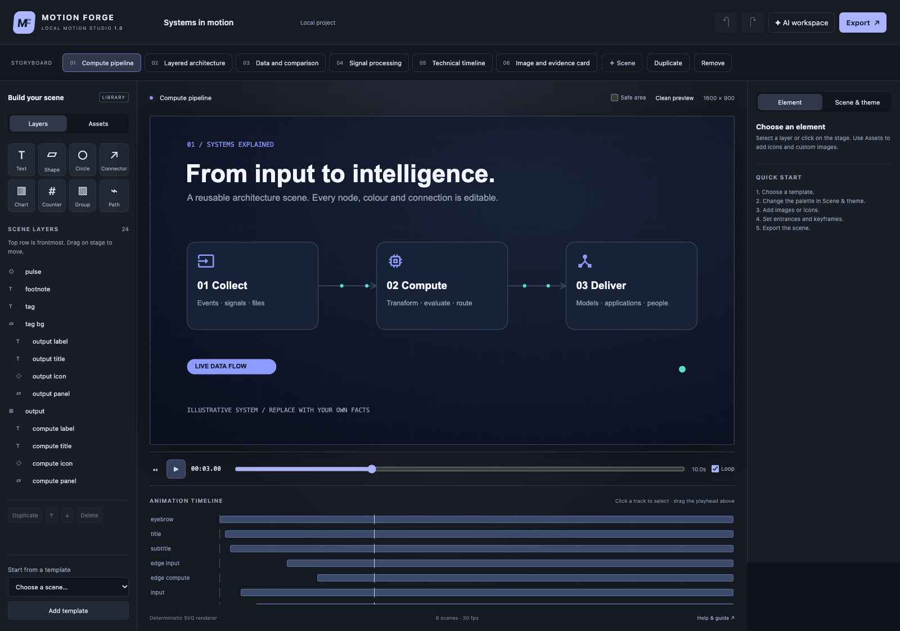

# WMGE — Web Motion Graphics Engine

Motion Forge is the local editor included in WMGE.

**A local SVG + WebGL studio for editable 2D/3D motion graphics — built for people and AI agents.**



Open **`index.html`** in a current Chrome or Edge browser. No installation, account, API key, CDN, build step or server is required for the editor. Everything runs locally. A local server is also available with `npm start` (Node 20+); open the address it prints.

## What you can build

- Technical diagrams, animated pipelines, product explanations, data comparisons, timelines, titles and evidence cards.
- 14 layer types: text, rectangles, ellipses, Material icons, Lucide symbols, custom images, video, connectors, SVG paths, counters, charts, groups, 3D scenes and effect layers.
- Solid, linear, radial or transparent backgrounds; 5 editable palettes; per-element colours; palette tokens that stay linked across scenes.
- **131 locally bundled Google Material Icons** with search, editable colour and vector export.
- **1,544 locally bundled Lucide elements** (ISC), with searchable vector strokes and editable colour.
- Procedural 3D models composed from boxes, spheres, toruses, knots, cones, cylinders and planes; editable camera, lighting, object transforms and keyframes.
- Glass transmission/refraction, reflective metal, animated water and translucent gas shaders; cast/receive shadows and a single planar mirror reflection.
- Custom MP4/WebM video backgrounds with graphics overlaid, source trimming, fit, playback speed and looping. Media stays embedded in portable projects.
- Five advanced starter compositions, animated 2D shadows and material-effect buttons.
- PNG, JPEG and WebP images; SVG logos and illustrations are checked and converted to crisp 2048 px PNGs on import. Images remain embedded in exported projects.
- unDraw illustrations you download yourself from undraw.co: choose **Image source → unDraw** to recolour its `#6C63FF` accent to your theme accent and record credit/source. **Depth** on any image asset adds it with a floating motion, drop shadow and breathing ground shadow. unDraw files are never downloaded automatically or bundled (unDraw License). **Local illustrations:** put SVGs you downloaded yourself in `assets/undraw-local/` (git-ignored, never committed or redistributed), run `npm run index:illustrations`, then open the app with `npm start`; the Assets panel lists them with search and adds one with recolour, credit and depth in a click. The folder is not available from `file://`.
- To copy a batch of your own downloads into that folder with safe file names and re-index it, run `npm run import:illustrations -- --move "%USERPROFILE%\Downloads\undraw_*.svg"`. Identical files are skipped.
- Timed entrances, exit fades, numeric and colour keyframes, 6 easing modes, looping tracks, moving data particles and connectors that follow animated nodes.
- A storyboard, layer inspector, drag positioning, keyboard nudging, undo/redo, timeline seeking and safe-area overlay.
- Portable JSON, vector SVG for 2D scenes, composited PNG, browser MP4/WebM when supported, and deterministic up-to-4K MP4/WebM through local FFmpeg.
- A model-independent authoring agent: guidelines, schema, examples, prompts, asset embedding and validation tools. Use your preferred LLM; no model service is included or contacted.

## Five-minute start

For examples of **every element, 3D geometry, material/effect, background and
technical scene**, see the [detailed prompt cookbook](docs/EXAMPLE_COOKBOOK.md).
Run `npm start` and open `http://127.0.0.1:4173/?demo=catalog` for the editable
catalog, or import [catalog.motion.json](examples/catalog.motion.json).

For five original narrative films with separate detailed prompts (technology,
scenery, recipe, meeting and social), see the [story showcase](docs/SHOWCASE.md).
After generating the reels, open `http://127.0.0.1:4173/examples/showcase/`
to watch all five, inspect their storyboards and open the editable projects.

For a full technical explainer built entirely in WMGE (3D chip, load/store, registers,
pipeline, caches, SoC and TrustZone), see the [ARM architecture film](docs/ARM_ARCHITECTURE.md).

**Demos gallery.** Run `npm start`, then click **▶ Demos** in the studio's top bar
(or open `http://127.0.0.1:4173/examples/demos/`). Every demo is a card: click
**Watch** to play it in the player, **Open in studio** to edit it, or view its prompt.
Videos and live engine playback always start from 0:00 on scene 1, and live
playback runs through every scene in order. Deep links: `examples/demos/?demo=<key>`
or `index.html?demo=<key>&play=1` (add `&loop=1` to repeat). Rebuild the gallery
(projects, manifest, posters) with `node scripts/build-demos.cjs`, and add
`--video --ffmpeg <path-to-ffmpeg>` to render the MP4 previews into the gitignored
`examples/demos/renders/` folder. Without a video, a card plays in the live engine.

1. Open `index.html`. Six original technical templates are already loaded.
2. Select a scene. Open **Scene & theme** to try palettes and backgrounds.
3. Click a layer, or pick it in the layer list. Edit its text, position, colour and motion. Drag on the stage; hold **Alt** while dragging a child to move its immediate group.
4. Open **Assets**. Search an icon, or upload an image and click **Add**. **Replace** swaps the selected image layer's asset.
5. Seek to a time, choose an animated property and value, then add a keyframe. The first new track gets a second baseline key automatically. For precise multi-key edits use **AI workspace → Load current JSON**.
6. Try **Advanced starter** for 3D/material scenes, or **Assets → Add custom video** for footage overlays.
7. **Export → Project JSON** saves editable work. SVG exports 2D; PNG includes all layers. Record MP4/WebM when supported, or use the deterministic FFmpeg exporter.

Local autosave is a convenience, not a backup. Large embedded images may exceed browser storage; the header will say **Download JSON to save**. Save a JSON file before clearing browser data, moving the app or closing a large unsaved project. Imported projects can be undone.

## Smart director: one line in, a finished illustrated film out

Open **Smart director** (the AI button), type a sentence such as *"Recipe for fluffy pancakes: flour, eggs, milk, butter"* or *"Quarterly results: revenue grew 42% to $3.5m, churn down to 2.1%"*, or pick a quick-start chip, then click **✦ Build it for me**. The director runs locally, with no model or network. It works out:

- **Story:** genre (technology, data, food, meeting, social, travel, education, health, security or general), the title, your items and your exact figures.
- **Timing and look:** duration, scene count, mood, colour words and requested materials (glass, liquid metal, water, gas, mirror, 3D).

It then builds a complete multi-scene project with layered atmosphere, beat-specific layouts (hook, cards, flow, 3D stage, counters, steps, quote, finale), chapter rails and transitions. It also adds matched illustrations from your local library as background, midground and foreground depth. Statistics are shown only when you supply them.

- **Copy smart prompt:** expands your short brief into a detailed production brief and illustration plan, with the director's draft attached, for any LLM. The LLM may answer with `{"project": {...}, "illustrations": [...]}` and the editor places the named local files with depth.
- **✦ Auto-add illustration depth** (Assets panel, or the director dialog) matches illustrations to every scene of the current project. Free space gets a floating foreground figure; otherwise it adds a faded background plate.
- Link straight to a build: `http://127.0.0.1:4173/?brief=Weekend%20in%20Kyoto`.

## Work with any LLM

In the editor, open **AI workspace**, describe your scene (one line is enough; see Smart director above), then **Copy smart prompt**. Paste it into your model. Paste the returned complete JSON back into the editor, validate and apply. Large image/video payloads are replaced by markers in the prompt; the editor restores them by existing asset ID. Keep the same project open while doing this. These markers are an editor import convenience; saved project files always contain real embedded images.

For a coding agent, give it [AGENTS.md](AGENTS.md) and [the Motion Forge agent](agent/motion-forge/SKILL.md). For chat-only LLMs, use [the portable system prompt](agent/motion-forge/SYSTEM_PROMPT.txt) with the [scene reference](references/scene-format.md), icon catalog and one example. No particular vendor or tool protocol is required.

An LLM can also embed local assets with:

```sh
node scripts/embed-assets.cjs draft.json assets.json final.motion.json
node scripts/validate.cjs final.motion.json
```

The asset manifest format and full workflow are in [the agent guide](agent/motion-forge/SKILL.md).

## Production rendering

The editor works without dependencies. The optional test/render tooling uses Playwright and requires Node 20 or newer:

```sh
npm install
npx playwright install chromium
npm test
npm run test:browser
node scripts/render.cjs --project examples/pipeline.motion.json --scene pipeline --out renders/pipeline --fps 30 --width 1920 --height 1080
```

Rendering advances to exact timestamps independently of playback speed. See [export recipes](docs/EXPORT.md) for direct 4K MP4/WebM, alpha sequences, all-scene renders, custom Chrome paths and limitations. `examples/advanced.motion.json` contains five editable 3D/material scenes. Run `npm run test:advanced` for 3D/video integration checks. Browser recording is a real-time preview; use the CLI for final production.

## Project structure

| Folder / file | Purpose |
| --- | --- |
| `index.html`, `src/` | Standalone editor, SVG engine, example scene builders, smart director (`src/director.js`), bundled icon registry |
| `assets/material-icons/` | Original SVGs, pinned upstream provenance and Apache license |
| `assets/vendor/`, `src/elements.js` | Local Three.js build, Lucide paths and original licenses; reproduce with `npm run build:vendor` |
| `agent/motion-forge/` | Portable agent skill, system prompt and reusable creative briefs |
| `references/` | Scene format and machine-readable JSON Schema |
| `examples/` | Complete, editable project files; original demonstration image |
| `scripts/` | Local server, validation, image embedding, schema generation and frame export |
| `tests/` | Renderer, validation, browser interaction, image and export checks |
| `docs/` | User guide, export instructions and verified capability notes |

## Scope and limits

This is a **hybrid SVG/WebGL motion graphics engine**. 3D modeling means procedural primitive composition, not a full vertex/face editor or external mesh importer. Gas/water/liquid-metal animations are deterministic stylized shaders, not fluid dynamics. Glass uses Three.js physical transmission and a local procedural reflection environment; the optional mirror is one planar reflection, not recursive ray tracing. Transparent glass refracts other objects within its own 3D viewport, not an arbitrary video behind that viewport. WebGL support is required only for 3D/effect scenes.

Video compositing is visual only: there is no audio mixer, full video editing timeline, After Effects import or automatic reconstruction of reference footage. Browser MP4 depends on codec support and browser recording is real-time; deterministic final MP4/WebM requires a separately installed local FFmpeg. Existing version-1 SVG projects remain compatible and usable without WebGL.

Text uses system fonts and explicit line breaks. `width` is a layout/selection box, not an automatic text-wrap rule. Check exported frames on the machine used for final rendering. SVG imports intentionally exclude text, scripts, filters, styles and external references; convert a complex logo to PNG first. Only local raster data is used in project image layers, avoiding network dependencies and canvas cross-origin failures.

Target: desktop Chrome/Edge. Responsive layout works on smaller screens, but dense diagrams are easier on desktop. Safari/Firefox may vary in video codec availability, SVG image decoding and local-file clipboard behaviour. No claim of full cross-browser parity is made.

## Publishing / contributing

This directory is the complete distributable source package. Publish it as its own repository or serve it on any static host. No original research, private footage, account paths or API credentials are included. `package.json` is marked private to avoid accidental npm publication; this does not prevent publishing the repository or website. Source repository: [WMGE — Web Motion Graphics Engine](https://github.com/vivek3071997/WMGE---Web-Motion-Graphics-Engine).

See [CONTRIBUTING.md](CONTRIBUTING.md), [LICENSE](LICENSE) and [THIRD_PARTY_NOTICES.md](THIRD_PARTY_NOTICES.md). Original engine, UI, agent text, templates and Three.js: **MIT**. Google Material Icons: **Apache-2.0**. Lucide: **ISC**. Your imported assets keep their own rights and licenses.
